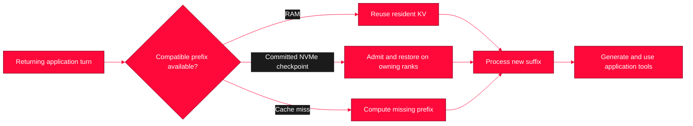

<div align="center">


# TensorShard

**Your local agents, prepared for the working day.**

<p>


</p>

[Project](https://github.com/abliter8-ai/Deepseek-v4.1F-TensorShard) · [Working day](#overview) · [Memory tiers](#how-it-works) · [Work Shards](#work-shards) · [Getting started](#how-to-start) · [Evidence](#evidence)

</div>

---

**TensorShard helps a pair of DGX Sparks retain more agent context and resume work with less repeated prefill.** It combines a tuned TensorFold serving recipe, unequal KV ownership and NVMe-backed restoration to keep a larger working set of local agent histories available.

The C12, worker-heavy, NVMe-backed configuration is **adopted for continued use**. This repository includes **Work Shards**, a small preparation helper for named profiles and saved sets, with a built-in DSH saved-session adapter. The serving recipe, integration notes and measured results sit alongside it. Broader native application integrations and a daily scheduler remain future work.

<a name="overview"></a>
## 

A working agent carries more than the latest question: repository instructions, `AGENTS.md`, tools, skills, documentation and conversation history. Its day alternates between generating, using tools, waiting and returning. Switching projects can mean returning to several substantial contexts.

Repeatedly computing the same prefix adds waiting and consumes capacity that could serve useful work. TensorShard combines more retained KV capacity with a second return path on NVMe. The intended experience is a local team ready to resume: coding agents, assistants, a researcher and a prompt writer, with room for ad-hoc requests.

Prewarming moves predictable preparation into quiet periods. Retention and restoration reduce how often it must be repeated. The first computation still costs time; the benefit comes from when it happens and how often it can be reused. Saved conversations remain distinct from the cached computation used to serve them.

### Who this is for

TensorShard is for people who spend a working day in **a couple of code repositories or a handful of recurring agent profiles**. Your agent may carry a large instruction set, tool schemas, project documents and hours of conversation. You want to make an edit, run tests, switch projects, ask an assistant something, then return to the same work without repeatedly rebuilding that history.

Imagine a history that takes **40 seconds to prefill**. That is an illustrative cost, not a new benchmark. You pay it when the compatible history is first prepared. On a later turn, the runtime can reuse the retained computation and process the appended instructions, tool results and conversation. If the compatible checkpoint has left RAM but remains committed on NVMe, it can be restored before continuing. The updated history can be retained and checkpointed for another return, subject to the store's commit and retention policy.

The useful cycle is **prepare → work → append → retain or save → return and resume**. Preparing a saved set before the working day moves that first cost away from the moment you need an answer. Tools and human pauses leave generation slots free; a dormant history need not occupy a slot to remain cached. This buys less waiting and more time doing useful generation, rather than a proportional increase in raw decode speed.

### What changes from the original recipe?

The concrete baseline is the original **C4 / 1,048,576-position deployment**, not a claim about every upstream recipe. Upstream already supplies caching and sharding mechanisms; TensorShard integrates and configures them for this larger retained working set.

| Working-day concern | Original C4 / 1M deployment | Adopted TensorShard configuration |
|---|---|---|
| Room for returning histories | One shared 1M-position pool | **4.20M positions**, with more KV placed on the worker |
| Active requests | Four generation slots | **Twelve slots**; retained histories can outnumber active turns |
| An older history leaves RAM | A cache miss requires preparation again unless another compatible tier is available | **Integrated NVMe return path** for retained, committed checkpoints |
| Preparing recurring work | Individual application use pays preparation when requested | **Work Shards** selects saved profiles and prepares them in sequence |

The aim is to pay the large preparation cost **once per compatible retained history**, then pay for appended material and any required restoration. It is not a promise that a session will never prefill again: early prompt edits, compaction, changed tools, incompatible configuration or eviction from both tiers can require recomputation. The measured approximately 196k-token example took **88.37 seconds cold, 1.28 seconds from RAM and 5.19 seconds from disk under load**.

You will benefit most when you revisit substantial, mostly stable contexts across many turns or project switches. Short one-off questions, unrelated prompts and workloads dominated by a single long generation benefit less from retention. The hardware's decode bandwidth is still finite; the gain is doing less repeated preparation during your active day.

<a name="what-it-does"></a>
## 

The adopted configuration uses two 128 GB GB10-class DGX Sparks, TensorFold, and DeepSeek-V4.1-Flash-1017 with the pinned Mia EXL3 EAQ 2.9-bpw checkpoint and Keys attention overlay. The project owner selected this configuration for continued use on **4 November 2026**, following the recorded qualification. The measurements below retain their original workload limits.

| Recorded capability | Configuration | Working-day benefit |
|---|---|---|
| Shared KV arena | **4,198,400 logical positions** | A larger working set of retained histories |
| Unequal ownership | **513 head / 1,537 worker blocks**, 2,048 positions per block | Places more KV on the worker, which has more spare memory |
| Active generation | **Up to 12 concurrent sequences** | Slots for competing active turns |
| Per-request context | **1,048,576 tokens** | A separate limit for one request |
| Persistent spill | **4 GiB NVMe store per rank** | A return path for compatible committed checkpoints beyond RAM |
| Restore handling | Bounded admission and corrected first-request context binding | Capacity contention can wait and retry instead of immediately triggering cold prefill |

Exact model, image, patch and environment pins are in the [recorded recipe](docs/recorded-recipe.yaml). The [implementation notes](docs/implementation.md) explain the integration and its inherited mechanisms.

<a name="how-it-works"></a>
## 

The head has more model/runtime responsibilities. Unequal KV placement uses the worker's greater remaining memory: **1,050,624 positions on the head** and **3,147,776 on the worker**. It improves usable retained capacity without adding physical bandwidth or removing compute, communication and thermal limits.



The **4.20M pool**, **1M request limit** and **12 active sequences** answer different questions. Twelve generation slots are not a twelve-history retention limit. Dormant retained contexts use cache capacity while slots serve other work. Growth, allocation overhead and the active working set still need headroom.

The **1 GiB prompt-state cache** has a different role from the KV arena; their sizes are not interchangeable token capacity. NVMe holds compatible checkpoints subject to commit, retention, quota and configuration limits. It is not conversation backup or an unlimited archive. Prefix changes, tool changes and compaction can reduce reuse. More retained capacity does not imply a proportional rise in single-stream decode speed.

<a name="work-shards"></a>
## Work Shards

A **Work Shard** is a named agent, project or workspace context you want prepared. It is a logical preparation profile, separate from a physical tensor shard or a rank's KV ownership.

Select named profiles or a saved set and prepare them sequentially with the included [Work Shards helper](work_shards.py). The DSH adapter resumes the same saved session in its original workspace and requests a short readiness reply. The engine reuses compatible RAM prefixes or NVMe checkpoints when available and computes missing context when needed. A 05:00 run remains a scheduling example; the helper does not install a timer.

| Example Work Shard | Intended context |
|---|---|
| Codex — `abliter8-fleet-cluster` | Repository work using local models exposed in the Codex app |
| DeepSeek harness — `rpstudios` | The project's DSH session and workspace |
| Professional productivity | Professional projects and their working material |
| Personal Hermes | The main personal assistant |
| Work Hermes | The work assistant |
| OpenWebUI researcher | The frequently used research agent |
| OpenWebUI image-prompt writer | The frequently used image-prompt-writing agent |

These seven profiles are an example selection. DSH has a built-in adapter; other applications can use an explicitly configured command that prepares their real context. Native Codex, Hermes and OpenWebUI adapters are not bundled. Leave capacity for conversation growth and unplanned work. Existing applications keep their loops, tools, retries, transcripts and checks.

The demonstrated building block is **eight real DSH sessions resumed in their original workspaces to perform checked code revisions**. The helper packages that SDK path with profile selection, saved sets and local completion receipts. A receipt records the last preparation; it does not prove the context is still resident. Preparing an unrelated request from concatenated repository files does not automatically warm an application's next turn. [Work Shards usage and boundaries](docs/work-shards.md).

<a name="how-to-start"></a>
## 

The helper requires Python 3.10 or newer and the application it will prepare. Start with `python3 work_shards.py init`, configure the private profile for an existing session, then select a saved set:

```sh
python3 work_shards.py list
python3 work_shards.py check --set daily
python3 work_shards.py prepare --set daily
python3 work_shards.py status
```

`check` opens and closes the DSH session without sending a model prompt. `prepare` performs a real application turn and can incur prefill on a cache miss. Local profiles and receipts are ignored by Git. See [setup and usage](docs/setup-and-usage.md) for configuration, command adapters and offline checks.

The image digests are evidence identities, not published image download locations. The [upstream recipe](https://github.com/MiaAI-Lab/DeepSeek-v4.1-Flash-1017-2x-DGX-Sparks/tree/f424dfe3b14ac9f02fe12f5777c852dba967a79a) describes its own setup; reproducing TensorShard also requires the recorded unequal-owner and spill integration.

<a name="evidence"></a>
## 

### Measured results

**Measure time to a checked outcome, including retries and tools.** A corrected attempt is still a successful task. Output rate is useful alongside returning-turn latency, completed work and the human intervention needed to keep it moving.

| Recorded workload | Result | What was checked |
|---|---|---|
| Eight warm writing agents, custom driver | **6,209 output tok/min**, 98.94% prefix reuse | 8 original briefs + 8 revisions; stated fact and structure checks |
| Eight warm coding agents, custom driver | **6,287 output tok/min**, 98.68% reuse | 8 new modules + 8 revisions; 48 initial + 56 revision test-method executions passed |
| Eight resumed **DSH** sessions | **6,151 output tok/min**, 93.05% reuse, **93.501 s** | 8 revisions; all 56 frozen checks passed through real application tools |
| Historical C8, approximately 196k-token return | TTFT: **88.37 s cold**, **1.28 s RAM**, **5.19 s disk** under four active agents | A concrete cold-to-disk first-token improvement of about **17×** |
| Client admission of eight versus twelve on the same C12 engine | **4,373 vs 4,472 output tok/min**, pooled | 72 checked edits and 72 handoffs across six arms; task throughput effectively tied |

The first three rows used eight agents with thinking disabled. The custom writing/code histories were synthetic and near 200k tokens; they were **not Codex-harness runs**. DSH used its actual application loop with approximately 27–32k contexts, and its measured task was revision only. Similar rates do not establish equal harness overhead. Current warm multi-agent Codex performance remains unmeasured.

Initial preparation is excluded. DSH's full timed window includes client startup, tools, final replies, validation and shutdown. Output counts include intermediate model output and tool arguments, rather than only final source-code tokens. Code cases share one algorithm family; writing used fictional briefs, with all outputs inside 650–1,200 words and seven of sixteen inside the approximate 800–1,000-word target. These checks establish the stated outcomes, not universal model quality.

Historical copy-heavy 9.5–10k tok/min results describe a different workload. A modelled gain over an older C4 scenario is a counterfactual, not a measured stock-versus-TensorShard A/B. The admission row also compares client limits on one C12 engine, not native C8 versus C12 deployments. These bounded results do not promise an all-day rate or qualify every application, compaction, reasoning or long-tool workflow. [Methods, limits and curated receipts](docs/evidence.md).

<a name="acknowledgements"></a>
## 

TensorShard builds on [DeepSeek](https://huggingface.co/deepseek-ai), [Mia's EXL3 quantization](https://huggingface.co/Mia-AiLab/DeepSeek-V4.1-Flash-1017-EXL3-EAQ-v1-2.9-bpw) and [two-Spark recipe](https://github.com/MiaAI-Lab/DeepSeek-v4.1-Flash-1017-2x-DGX-Sparks), the [Keys overlay by drowzeys](https://huggingface.co/drowzeys/keys-DeepSeek-V4.1-Flash-1017-Abliterated), [TensorFold](https://github.com/ashhart/TensorFold), and [sehoon's tuned recipe](https://github.com/sehoon123/DeepSeek-v4.1-Flash-1017-2x-DGX-Sparks-Tuned/tree/0700221). Prefix caching, speculative decoding, KV sharding and NVMe caching predate this project.

The specific contribution is making unequal worker-heavy ownership work across allocation, addressing, movement, kernels and compatibility, then integrating owner-aware spill packing, ordered rank coordination and restore/teardown corrections. The workflow direction is to put that retained capacity behind a user's daily selection of agents and projects. [Implementation and upstream attribution](docs/implementation.md).
